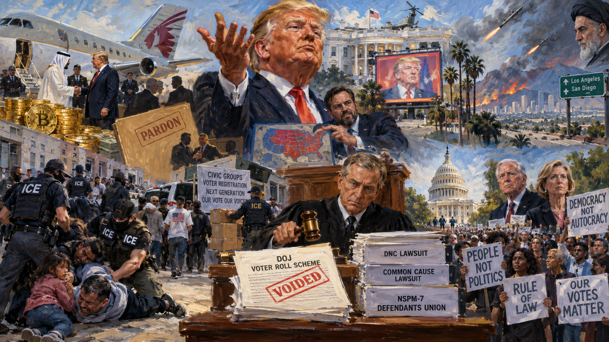

<!-- Generated by build_publish_week_v1 (appendix post) -->
<!-- Header image: image_wide_week90_appendix.png -->

# Week 90 Appendix: The Week the Clock Held Still

*Amid fund diversions, an ICE shooting, and claims of unlimited power, courts and citizens pushed back hard enough to hold the line.*

This was a week of accelerating institutional strain as the midterm campaign intensified alongside open assertions of unchecked executive authority. Trump explicitly claimed "I can do whatever I want," diverted DHS funds for self-promotional ads, floated nationalizing election seizure with a convicted election denier, and suggested letting Iran destroy Los Angeles and San Diego — rhetoric met with bipartisan alarm. ICE's shooting of a man with a child present in Manhattan, mass ICE detentions of U.S. citizens, and DHS's covert targeting of voter-registration groups revealed an enforcement apparatus turning inward against civil society ahead of the election. Simultaneously, courts and plaintiffs pushed back: a federal judge voided DOJ's voter-roll collection scheme, the DNC and Common Cause sued over taxpayer-funded political ads, and a defendants' union formed to counter NSPM-7 prosecutions. Financial entanglements (Qatar jet, crypto profits, pardoned-donor business deals) and retiring senators' candid warnings about authoritarian drift rounded out a week defined by brazen self-dealing paired with resilient, if strained, institutional resistance.

Power and Authority

1. Trump ordered Office of Management and Budget to divert $20 million in Department of Homeland Security funds for television ads praising himself (2026-10-03): Redirecting congressionally appropriated DHS funds for campaign-style self-promotion bypasses legislative control over spending and raises emoluments concerns.

2. Trump announced distribution of Medicare Part B premium payments to seniors from the Medicare Improvement Fund, tying future larger payments to a Republican midterm win (2026-10-04): Using a health program fund for pre-election cash payments and linking a bigger payout to an election outcome blurs the line between governance and campaign inducement.

3. Trump promised $5,000 payments to all adult citizens if Republicans win the midterm elections (2026-10-06): A presidential pledge of direct cash payments contingent on an election outcome uses the power of the office to influence voters without a specified funding mechanism.

4. Trump signed an executive order deferring diesel fuel excise taxes and penalties through December 31, 2026 (2026-10-05): Unilaterally suspending federal tax collection and directing exploration of permanent forgiveness extends executive reach into tax and appropriations authority reserved to Congress.

5. Jared Kushner negotiated with Russian President Putin to purchase sanctioned Lukoil assets at depressed prices, benefiting Trump-linked investors (2026-10-03): Using informal White House-linked channels to arrange a lucrative deal with a wartime adversary raises conflict-of-interest and foreign-influence concerns over U.S. foreign policy.

6. U.S. Southern Command conducted its 70th strike on a Caribbean boat, killing four more people without public evidence or judicial process (2026-10-04): Continuing extrajudicial lethal strikes without transparent legal justification bypasses courts and due process in matters normally handled by the justice system.

7. Trump stated he could have prosecuted Clinton, Biden, and Obama but chose restraint, then asserted "I can do whatever I want" (2026-10-07): A sitting president's explicit claim of unlimited personal power undermines constitutional limits and signals willingness to use prosecution selectively against rivals.

8. Trump suggested at campaign rallies that Iran could "take out" Los Angeles and San Diego, calling the loss "a small price to pay" (2026-10-05): A president publicly accepting the destruction of major American cities by a foreign adversary undermines the basic duty to protect citizens and alarmed officials across party lines.

9. Trump met with election denier Tina Peters at the White House to discuss seizing voting machines and ballots nationwide (2026-10-05) *[single source]*: Presidential engagement with a convicted election official over plans to seize ballots threatens the constitutional process for certifying elections and the peaceful transfer of power.

10. Trump endorsed building a Camp David-style presidential retreat on his own golf club property (2026-10-09): Linking federal presidential facilities to a privately owned Trump property blurs the separation between public office and personal financial interest.

11. Trump announced a deal with Putin for Russia to supply growing volumes of diesel fuel to the U.S. market ahead of the midterms (2026-10-09): Striking an energy deal with a wartime adversary just before elections drew accusations of funding Russia's war effort and using foreign policy for domestic political gain.

Institutions and Governance

1. Tennessee Governor Bill Lee suspended executions through year-end and ordered an independent inquiry after the state's prison chief failed to implement reforms following botched executions (2026-10-03): Executive suspension of executions and an independent probe respond to documented institutional failure to follow safety recommendations in capital punishment procedures.

2. Justice Samuel Alito gave a rare interview discussing his annual contemplation of retirement and the personal toll of the Dobbs decision (2026-10-04) *[single source]*: A sitting justice's public remarks on possible retirement and the Court's strained independence affect public understanding of the Court's stability and future composition.

3. Ninth Circuit Court of Appeals granted the government an administrative stay pending appeal in Rogoff v. Trump without ruling on the merits (2026-10-04): A procedural stay keeps a legal challenge to an administration action in limbo, illustrating the ongoing churn of litigation testing executive conduct.

4. Senate approved bipartisan legislation easing mental health treatment barriers for pilots and air traffic controllers (2026-10-05) *[single source]*: Removing stigma-driven regulatory barriers to treatment-seeking among aviation professionals strengthens both worker rights and public safety through better oversight design.

5. Supreme Court heard oral arguments in Suncor Energy v. Boulder County on whether federal law preempts state climate-damage lawsuits (2026-10-05): A ruling favoring oil companies could eliminate state-level climate accountability litigation nationwide, reshaping the balance between federal preemption and state authority.

6. District Court (N.D. Cal.) allowed two plaintiffs to voluntarily dismiss claims without prejudice in Global Nurse Force v. Trump (2026-10-05): A routine partial dismissal narrows one ongoing legal challenge to an administration policy while leaving other plaintiffs' claims intact.

7. Senate Democrats signaled they will not confirm Trump Supreme Court nominees if they win control of the chamber (2026-10-05): A pledge to block judicial confirmations regardless of nominee qualifications signals deepening politicization of the confirmation process across both parties.

8. Supreme Court issued a batch of October 5 orders denying stays, granting certiorari with vacatur and remand in multiple cases, and permitting Solicitor General participation in two arguments (2026-10-05): Routine orders deciding procedural questions in immigration, criminal, and election cases shape which disputes receive further judicial review this term.

9. Federal judge Paul Engelmayer ordered the Pentagon and DOJ to produce the legal memo justifying boat strikes and disclose who reviewed it (2026-10-06): Judicial demand for disclosure of a classified legal opinion underlying lethal military action reasserts court oversight of executive claims of authority.

10. Samuel Alito stated he does not anticipate the Court overturning Obergefell v. Hodges (2026-10-06): A justice's public prediction about the fate of a major constitutional precedent shapes public expectations about the Court's direction on established rights.

11. District Court (D.D.C.) denied both a preliminary injunction and a motion to dismiss in Smith v. U.S. Department of Defense over a Pentagon ombudsman's retaliation claim (2026-10-06): The court left open unresolved First Amendment questions about retaliation against a public employee for critical speech made within her official role.

12. Congress enacted the Billion Dollar Boondoggle Act of 2025 and the Improving Social Security's Service to Victims of Identity Theft Act into law (2026-10-07): Bipartisan enactment of oversight and consumer-protection legislation reflects functioning legislative process affecting federal spending scrutiny and identity-theft victim services.

13. Common Cause filed suit challenging a $20 million DHS-funded advertising contract featuring Trump as an illegal use of appropriated funds for campaign purposes (2026-10-07): The lawsuit tests whether executive branch use of appropriated funds for self-promotional ads violates statutory limits on propaganda spending and equal-protection principles.

14. District Court (D.D.C.) granted in part a stay of DHS's biometrics policy for detained immigration applicants in Z. v. DHS, finding the policy likely arbitrary and capricious (2026-10-07): The ruling found DHS failed to justify a policy that risked preventing detained applicants from pursuing their immigration cases, reinstating stronger procedural protections.

15. Supreme Court denied habeas corpus, mandamus, and certiorari petitions in the capital case of Jamaal Howard, with Justice Jackson dissenting from one denial (2026-10-07): Final denials of emergency review in a death penalty case close off further judicial avenues before the scheduled execution, with one justice registering dissent.

16. Democracy Docket analysis reported that the Supreme Court's Louisiana v. Callais decision gutted Voting Rights Act protections, prompting a wave of Southern redistricting (2026-10-08): Removal of a foundational federal voting-rights constraint enabled Alabama, Florida, Louisiana, and Tennessee legislatures to redraw maps targeting Black voting power.

17. Democratic National Committee sued the Trump administration to stop use of taxpayer funds for self-promotional campaign ads (2026-10-08): The lawsuit raises constitutional separation-of-powers and appropriations questions about executive use of public money for partisan self-promotion during the midterm season.

18. Judge Sparkle Sooknanan ruled that DOJ's collection of unredacted state voter rolls for cross-checking against immigration databases was unlawful (2026-10-08): The ruling blocks a federal attempt to seize control of voter-roll data from states, protecting citizens from erroneous removal from registration lists ahead of the midterms.

19. Judge I'Ashea Myles ordered Tennessee to preserve all evidence from the execution chamber after Christa Pike survived lethal injection (2026-10-08): Judicial intervention to preserve evidence from a failed execution addresses concerns about concealment and supports future legal challenges over cruel and unusual punishment.

20. Department of Justice filed a complaint against Denver challenging its mask ban and identification requirements for federal law enforcement officers (2026-10-08): The suit tests whether a city can require federal officers to display identification and forgo masks during enforcement operations within its jurisdiction.

21. Department of Justice filed motions defending a rule rescinding the regulatory definition of "harm" under the Endangered Species Act (2026-10-08): Defending a narrowed definition of species harm in court affects the scope of federal environmental protections against habitat destruction.

22. New Mexico Wildlife Federation and border-region groups sued the Department of the Interior and Department of Defense over the transfer of 110,000 acres to military control for border security (2026-10-08): The suit challenges executive authority to transfer public lands and militarize immigration enforcement without statutory authorization, raising separation-of-powers questions.

23. Supreme Court issued an emergency stay of a Fourth Circuit judgment in FCC v. Sherrod Brown (2026-10-08): An emergency Supreme Court stay involving a federal agency and a sitting senator signals a significant unresolved dispute requiring expedited high-court attention.

24. Manhattan District Attorney's Office opposed Luigi Mangione's motion to dismiss state murder charges on double jeopardy grounds (2026-10-09): The filing tests the boundary between federal and state prosecution authority and New York's double jeopardy protections in a high-profile case.

25. Supreme Court earlier in 2026 upheld state laws excluding transgender girls and women from female sports (2026-10-09): The ruling narrowed transgender rights and gave legal cover for Republican campaign messaging attacking Democratic candidates during the midterm cycle.

26. Disney and ABC filed a federal court challenge to the FCC's early review of broadcast licenses for eight ABC-owned stations (2026-10-09): The challenge argues the license review retaliates against disfavored editorial decisions, testing whether regulatory power can be used to coerce broadcast content.

27. Arlington County Board filed suit against the Trump administration to block construction of a presidential triumphal arch in Washington, D.C. (2026-10-09): A local government's legal challenge to a federal monument project tests the limits of executive discretion over public space and spending priorities.

28. Democratic congressional leadership outlined plans to pursue subpoena-backed investigations into Trump family business dealings, Epstein files, Pentagon contracts, and other matters if they win control of Congress (2026-10-09): Articulated oversight plans show how a change in congressional control could restore subpoena power and committee capacity for checking executive conduct.

Economic Structure

1. Federal Register publication formalized Executive Order 14435 deferring diesel fuel excise taxes through December 31, 2026 (2026-10-09): Official publication of the tax-deferral order confirms an executive attempt to suspend federal revenue collection and explore permanent tax forgiveness without legislative approval.

2. AM General employees and PAC donated tens of thousands of dollars to key appropriations committee members after Congress funded armored vehicles the Army said it did not need (2026-10-05): A pattern of defense-contractor donations following congressional funding of unneeded equipment raises concerns about pay-to-play influence on military appropriations.

3. Iowa state government approved a $1.36 billion incentive package for a new steel plant costing at least $777,000 per job created (2026-10-05): An incentive package far exceeding typical per-job costs, tied to a politically promoted deal, raises questions about misuse of public resources for electoral messaging.

4. Gulf oil producers and shipping companies increased oil shipments from the Persian Gulf despite wartime attack risks, driving freight costs to $40 million per trip (2026-10-05): War-driven disruption and record shipping costs in a critical energy corridor illustrate the economic toll of ongoing military conflict on global markets.

5. Washington, D.C. tourism industry experienced steep declines as international visitors cited anger over Trump's tariffs, immigration policy, and treatment of allies (2026-10-05) *[single source]*: A sharp drop in international tourism to the capital reflects reputational damage to U.S. soft power resulting from administration policies and rhetoric.

6. Trump administration announced sweeping tariffs on trading partners, then repeatedly reversed, modified, and exempted them, creating sustained trade-policy uncertainty (2026-10-05) *[single source]*: Volatile tariff policy discourages business investment and planning, generating macroeconomic uncertainty that affects employment and growth nationwide.

7. FDA issued routine medical device classifications, drug withdrawal corrections, and regulatory determinations affecting pharmaceutical and device markets (2026-10-06): Ordinary regulatory actions on device classification and drug approvals shape market access and safety oversight for patients and manufacturers.

8. Trump accepted a $400 million aircraft gift from Qatar for use as Air Force One (2026-10-06): Accepting a massive foreign gift as a sitting president raises constitutional emoluments concerns and questions about foreign influence over the executive branch.

9. Trump disclosed $2.2 billion in business earnings during his first year back in office, including $1.4 billion from a family cryptocurrency venture (2026-10-06) *[single source]*: The scale of presidential business income while in office raises constitutional emoluments concerns and questions about personal enrichment from the presidency.

10. Trump accepted a memecoin dinner invitation for top crypto investors while personally profiting roughly $636 million from the coin last year (2026-10-06) *[single source]*: A pay-to-access dinner tied to a presidential cryptocurrency venture illustrates ongoing monetization of the office during an election cycle.

11. Federal Transit Authority announced plans to steer infrastructure grants toward areas with higher birthrates and marriage rates (2026-10-06) *[single source]*: Conditioning federal infrastructure funding on demographic reproductive metrics reflects a racialized ideology and departs from neutral public-goods allocation criteria.

12. Food & Water Watch reported U.S. household water prices rose 62% over the past decade, outpacing inflation and wages (2026-10-06): Rapidly rising water costs strain household budgets and disproportionately burden low-income families heading into the midterm elections.

13. Trump meme coin firm insiders offered perks to encourage public buying of cryptocurrency while moving $70 million of insider holdings toward sale (2026-10-06) *[single source]*: Insiders selling while promoting purchases to the public raises concerns about market manipulation connected to the president's name and image.

14. Department of War's Office of Strategic Capital announced multi-billion-dollar loan commitments and contracts to private semiconductor, quantum, and missile-defense firms (2026-10-07): Large military-linked loans and contracts to private technology and defense firms illustrate deepening public-private entanglement in strategic industrial policy.

15. EPA approved multiple state air-quality implementation plans affecting ozone, nitrogen oxide, and sulfur dioxide standards across several states (2026-10-08): Routine approvals of state environmental regulations shape enforceable federal air-quality standards affecting industrial emissions and public health protections.

16. Department of Transportation pursued regulatory changes weakening airline passenger protections on pricing disclosure and flight-disruption compensation (2026-10-08) *[single source]*: Rolling back consumer protections without new evidence of harm favors airline industry interests over passenger rights and government's protective role.

17. FDA extended its safety review of mifepristone into 2027 following pressure from anti-abortion groups (2026-10-08): A politically pressured, prolonged regulatory review of an approved medication risks weaponizing the FDA process to restrict reproductive-health access.

18. DHS purchased five aircraft at a considerable markup from a political donor of outgoing Secretary Kristi Noem, including a $108 million luxury jet (2026-10-09): A high-value procurement from a political donor at inflated prices on an outgoing official's last day raises concerns about corruption in government contracting.

Civil Rights and Dissent

1. Tom Morello and participating musicians organized the Power to the People festival with voter-registration resources and proceeds donated to a nonpartisan voting-access group (2026-10-03): A large-scale concert combining political speech with voter-registration drives exercised First Amendment rights and promoted civic participation ahead of the midterms.

2. Dário Sánchez and Texas state prosecutors faced repeatedly amended terrorism-related charges for moderating an online chat tied to a protest he did not attend (2026-10-06) *[single source]*: Prosecuting a non-attendee over online chat moderation, alongside extreme sentences for co-defendants, shows weaponized use of the justice system against political association.

3. NSPM-7 Defendants Union launched a collective defense organization offering legal clinics and coordinated strategy for people prosecuted under the president's NSPM-7 memorandum (2026-10-06) *[single source]*: Formation of a defendants' union represents organized civil-society resistance to government prosecution of protest activity across multiple movements.

4. Governor Gavin Newsom publicly denounced Trump's suggestion that Iran attack Los Angeles and San Diego as "deranged and dangerous" (2026-10-06): A state executive's public rejection of presidential rhetoric endorsing attacks on American cities marks a significant institutional pushback on public-safety grounds.

5. San Diego Mayor Todd Gloria rejected Trump's framing of San Diego as an acceptable loss, stating the city is not expendable (2026-10-06) *[single source]*: A local executive's rejection of being characterized as a disposable casualty in geopolitical rhetoric asserts municipal duty to protect residents.

6. Voto Latino Foundation and Hispanic Federation launched a six-figure voter mobilization effort targeting underrepresented Latino voters in Texas's Rio Grande Valley (2026-10-06) *[single source]*: Grassroots voter-mobilization campaigns aim to expand electoral participation among historically underrepresented eligible voters in a swing region.

7. FBI arrested an 18-year-old after supplying him with an AK-47 in an undercover sting targeting the Mall of America (2026-10-07) *[single source]*: A nearly two-year undercover operation culminating in federal agents providing a weapon to a suspect raises serious entrapment and civil-liberties concerns.

8. NAACP sued the Trump administration challenging plans to deploy roughly 1,000 federal election monitors to midterm polling sites (2026-10-07) *[single source]*: The suit argues the planned deployment lacks statutory authority and risks voter intimidation, raising constitutional concerns about federal interference in elections.

9. Bo French tweeted outrage at Indian American children attending a University of Texas football game, sparking broader anti-Indian sentiment online (2026-10-07): A state candidate's public targeting of an ethnic minority group normalized exclusionary rhetoric against an immigrant community in political discourse.

10. DOJ sought a federal criminal indictment of former White House aide Cassidy Hutchinson for alleged perjury in her January 6 congressional testimony (2026-10-08): Prosecuting a key January 6 witness through an unusual DOJ channel raises concerns about retaliation against testimony damaging to the former administration.

11. Pentagon Secretary Pete Hegseth announced a public, livestreamed military execution of Fort Hood shooter Nidal Hasan, the first in over 60 years (2026-10-08): Plans to broadcast a military execution represent a significant departure from past practice, drawing bipartisan criticism over dignity and spectacle in capital punishment.

12. Texas Department of Criminal Justice executed Jamaal Howard by pentobarbital hours after the same drug caused complications in another execution (2026-10-08): Proceeding with an execution using a drug shown to fail hours earlier raises acute concerns about courts failing to prevent foreseeable cruel and unusual punishment.

13. Homeland Security Investigations investigated over 150 voter-registration organizations and considered undercover operations against them, finding no derogatory information in most cases (2026-10-08): Broad federal investigation of civic organizations, including civil rights groups, under the guise of election security risks chilling protected political activity.

14. ICE collected tens of millions of voter records for integration into a deportation-targeting database (2026-10-08): Mass collection of voter data by immigration enforcement for deportation targeting threatens legal residents and chills participation in the democratic process.

15. Billionaire donors funded California Proposition 39, a ballot measure requiring voter identification at polls and on mail ballots (2026-10-08): Large donor funding behind a voter-ID ballot measure could restrict ballot access for eligible voters lacking required documentation, narrowing participation.

16. ICE agent Brenden Cuni shot a man in the neck during an enforcement operation in Manhattan's Marble Hill with a 5-year-old child present in the vehicle (2026-10-08): An immigration enforcement shooting with a child in the vehicle, involving an agent with a documented history of unlawful arrests, raises serious use-of-force accountability concerns.

17. NYC Mayor Zohran Mamdani demanded ICE's removal from the city after the shooting, criticizing agents' tactics as terrorizing residents (2026-10-08): A mayor's public demand for federal agency withdrawal highlights escalating tension between local government and immigration enforcement over public safety.

18. DHS Secretary Markwayne Mullin defended ICE's shooting tactics and dismissed the mayor's criticism as dangerous (2026-10-09): A federal official's defense of controversial enforcement tactics amid public outcry reflects reluctance to hold immigration enforcement accountable for use of force.

19. ProPublica reporting found ICE detained U.S. citizens over 500 times during the second Trump administration, including at least 70 children and teens (2026-10-09) *[single source]*: Mass detention of citizens, including children, by immigration authorities without clear legal basis undermines constitutional due-process protections.

20. Trump administration transferred undocumented children living with their parents into ORR custody while detaining the parents (2026-10-09) *[single source]*: Reclassifying children to separate them from detained parents already residing in the country revives family-separation practices with constitutional and humanitarian implications.

21. Super PAC supporting Darline Graham aired an anti-transgender attack ad against South Carolina Senate candidate Annie Andrews (2026-10-09): A coordinated anti-trans attack ad in a competitive Senate race weaponizes culture-war rhetoric against vulnerable communities to polarize the electorate.

22. Trump made inflammatory statements accusing Somali immigrants in Minnesota of crime and urging residents to "fight back" (2026-10-09): Presidential rhetoric targeting a specific immigrant community and urging vigilante action creates conditions for community harm and undermines equal protection.

23. Federal agents arrested protesters attempting to prevent destruction of an ancient cottonwood tree during border wall construction (2026-10-09) *[single source]*: Arresting protesters engaged in civil disobedience against a federal infrastructure project raises questions about the scope of permitted dissent.

24. Representative Austin Scott, Senator Thom Tillis, and Senator Jon Ossoff publicly criticized the Pentagon's plan to livestream a military execution as obscene and comparable to dictatorship tactics (2026-10-09): Bipartisan congressional criticism of a planned public execution broadcast reflects shared concern over state-sanctioned spectacle and the dignity of capital punishment.

Information, Memory and Manipulation

1. Trump White House repeatedly barred Politico and CNN from the Air Force One press pool despite a court order requiring reinstated access (2026-10-04): Continued exclusion of news organizations after a judicial order violates First Amendment press-access rights and signals defiance of court authority.

2. Popular Information launched PaidForBy.info, a tool letting voters identify who funds political mailers and ads (2026-10-04) *[single source]*: A public transparency tool closes an information gap in political advertising, enabling citizens to scrutinize campaign spending and funding sources.

3. Changpeng Zhao publicly advocated for dictatorship over democracy as more efficient in a New York Times interview (2026-10-06): A Trump-pardoned businessman with family financial ties publicly endorsing authoritarian governance signals ideological alignment undermining democratic norms.

4. Trump accused the New York Times of doctoring a photograph of his Miami club and called for arrests of media outlets for dishonesty (2026-10-06) *[single source]*: False accusations against a major newspaper combined with threats of criminal prosecution attack press independence and normalize punishing unfavorable coverage.

5. Trump posted carefully cropped rally photographs to dispute news coverage showing sparse attendance (2026-10-06) *[single source]*: Deliberate visual manipulation to contradict documented news photographs undermines factual accountability and public trust in official communications.

6. Senator Mike Lee suggested without evidence that U.S. government funding, possibly through Fauci, was involved in a Russian plague researcher's death (2026-10-06) *[single source]*: An unfounded conspiracy theory from a sitting senator spreads disinformation and erodes public trust in scientific institutions.

7. Trump publicly pressured Fox News over interviews with Democratic candidates, calling coverage "softball" and demanding more favorable treatment (2026-10-06): Direct presidential pressure on a television network to alter editorial decisions represents an attempt to control news coverage of political opponents.

8. Trump declared that use of the term "Artificial Intelligence" instead of "Super Intelligence" makes someone "THE ENEMY" (2026-10-08): Declaring standard terminology enemy speech reflects an attempt to enforce linguistic conformity across federal communications and punish deviation from official framing.

9. Trump posted false claims that Senate candidate James Talarico was "missing in action" while Talarico was recovering from illness (2026-10-08): Spreading false claims about an opponent's whereabouts and health represents deliberate disinformation intended to damage a political rival before an election.

10. Texas PAC and V-PAC distributed campaign mailers with acknowledged false claims about Senate and gubernatorial candidates' policy positions (2026-10-09) *[single source]*: Super PACs knowingly circulating false claims in campaign mailers distort voter understanding of candidates' actual positions during the final weeks before elections.

11. Heather Honey and DHS placed an election denier in a prominent role directing investigations into alleged noncitizen voting ahead of the midterms (2026-10-09): Assigning an election denier to lead voting-fraud investigations raises concerns that enforcement is driven by ideology rather than evidence of actual violations.

12. David Schoen (Trump's lawyer) issued a statement attacking the Nobel Committee's award to Navi Pillay as a "phony" decision motivated by anti-American bias (2026-10-09): An official attack on an international institution's independent judgment seeks to discredit accountability findings regarding allied military conduct.

