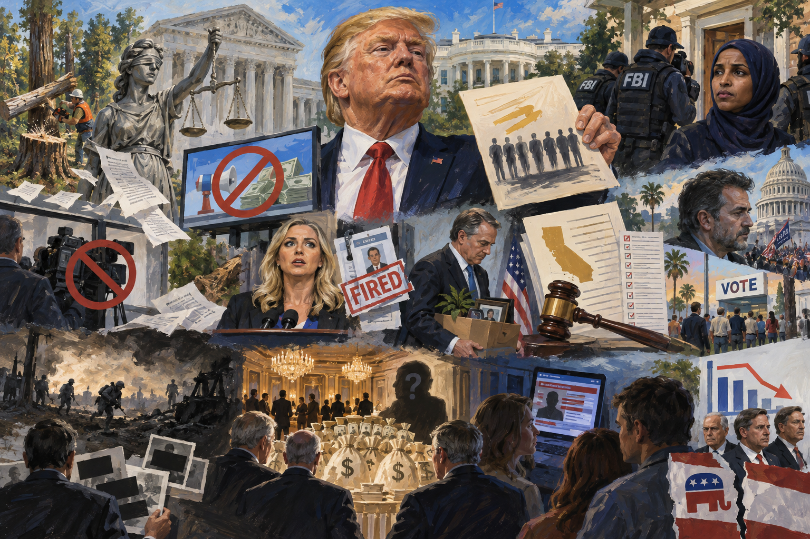

<!-- Generated by build_publish_week_v1 (appendix post) -->
<!-- Header image: image_wide_week91_appendix.png -->

# Week 91 Appendix: Pressure Rises, Balance Barely Holds

*A week of raids, prosecutions, and defiance met courts, dissent, and cracks in party loyalty, leaving the clock nearly still.*

This week showed an administration operating with sustained defiance of judicial authority alongside an escalating campaign against political opponents ahead of midterms. Federal judges repeatedly found the administration in violation of court orders—felling protected trees despite warnings, continuing banned taxpayer-funded ads, and unlawfully banning journalists—while DOJ simultaneously raided Rep. Ilhan Omar's home seeking to strip her citizenship, pursued perjury charges against a January 6 witness, and sued California over voter rolls weeks before an election. A chaotic personnel week saw a Pizzagate-promoting press secretary hired and fired within five days amid credential fraud revelations, and an ambassador resigned over a bribery scandal, while Trump floated self-pardons for his entire administration. Disinformation campaigns targeting Senate candidates, massive billionaire election spending, and continued obscuring of war casualties and executive privilege claims over a luxury ballroom's secret donors rounded out a week defined by institutional strain, retaliatory law enforcement, and normalized untruth, even as courts, polling, and internal GOP defections signaled resistance and electoral headwinds for the administration.

Power and Authority

1. Trump petitioned the Supreme Court to revive a dismissed racketeering suit against Clinton and Elias and overturn nearly $1 million in sanctions (2026-10-10): A sitting president asked the Supreme Court to erase sanctions and revive a dismissed lawsuit against political rivals, raising concerns about using courts against opponents.

2. Trump administration continued running taxpayer-funded campaign-style ads despite a federal court order to stop (2026-10-12): The administration defied a judge's order halting taxpayer-funded political advertising, testing whether executive power is bound by judicial rulings.

3. Trump administration felled more than 400 trees at East Potomac Golf Links despite a judge's warning against irreversible changes (2026-10-12): The government destroyed protected parkland in apparent defiance of explicit judicial instructions, prompting a judge to say it had lost all credibility with the court.

4. Frank Lance testified that the Deputy Chief of Staff for the Interior Department directed the urgent tree removal (2026-10-12) *[single source]*: Sworn testimony traced an order for sudden tree removal to top Interior officials, suggesting coordination to act before a court could stop the work.

5. Judge Reyes ordered National Park Service officials to preserve all communications about the tree removal plan (2026-10-12) *[single source]*: A federal judge ordered preservation of government records tied to a disputed tree-cutting operation, a safeguard against potential destruction of evidence of executive wrongdoing.

6. Department of Homeland Security conducted a predawn raid on Representative Ilhan Omar's home (2026-10-12): A federal raid on a sitting Democratic lawmaker's home before an election, targeting decades-old paperwork from when she was a minor, raised concerns about using state power to intimidate opponents.

7. Trump administration investigated Representative Ilhan Omar's citizenship paperwork and seized her phone, computers, and passport with the stated goal of stripping her citizenship and deporting her (2026-10-13): Federal agents seized a sitting congresswoman's property in an investigation explicitly aimed at revoking her citizenship weeks before her reelection, raising due-process and selective-prosecution concerns.

8. Federal prosecutors sought a grand jury indictment of former Meadows aide Cassidy Hutchinson for perjury (2026-10-13): Prosecutors pursued a perjury case against a witness who testified to Congress about Trump's conduct, a move critics say could discourage future cooperation with oversight.

9. Justice Department pursued a criminal case against Representative LaMonica McIver over a skirmish with immigration agents in which no one was hurt (2026-10-13): A sitting representative faces up to 17 years in prison for conduct that injured no one, part of a pattern of prosecuting Democratic women of color that raises selective-enforcement concerns.

10. Trump pardoned nine of the last eleven Republican members of Congress convicted of federal crimes while his DOJ pursued thirteen sitting Democrats (2026-10-13): A stark disparity in pardons versus prosecutions by party affiliation points to selective application of justice based on political loyalty.

11. Trump suggested he would pardon everyone in his administration, including himself (2026-10-15) *[single source]*: The president floated blanket pardons for himself and aides to shield them from legal consequences, raising fundamental rule-of-law concerns about accountability.

12. Trump discussed his belief that he is allowed to pardon himself (2026-10-16) *[single source]*: The president publicly asserted a constitutional power to pardon himself, a claim that would undermine checks on executive accountability if acted upon.

13. Trump unilaterally declared an energy ceasefire between Russia and Ukraine without formal negotiation or confirmed agreement (2026-10-11): The president announced a wartime ceasefire by social media post without clear diplomatic process or allied confirmation, raising concerns about bypassing normal foreign-policy channels.

14. Trump suspended sanctions on Russian diesel imports in a deal with Putin (2026-10-11): The administration lifted sanctions on a wartime adversary's oil exports, a unilateral action with foreign-policy consequences that bypassed Congress and strained relations with Ukraine.

15. Trump administration threatened to suspend intelligence sharing and weapons sales to Ukraine unless it stopped striking Russian energy facilities (2026-10-12): The government used military aid as leverage to limit an ally's defensive actions against an invading power, raising concerns about undermining collective defense commitments.

16. Trump withheld advance intelligence warning to Ukraine about a Russian missile strike (2026-10-14): Ukraine received no warning of a deadly overnight strike, raising concern that the administration is curbing intelligence sharing to pressure an ally.

17. SpaceX restricted Starlink and Starshield speed limits for Ukraine's military during a major Russian missile and drone barrage (2026-10-14): A private contractor controlling critical military satellite communications degraded an ally's defense capability during an active attack, raising questions about civilian control of defense infrastructure.

18. Trump denied knowledge of who restricted Starlink access for Ukraine's military (2026-10-16): The president disclaimed responsibility for a decision that weakened an ally's defenses, obscuring accountability for a consequential policy choice.

19. Trump criticized Ukraine and President Zelenskyy, calling him more difficult to deal with than Putin (2026-10-16): Public statements undermining confidence in a wartime ally while expressing preference for dealing with an adversary weaken diplomatic alignment and alliance trust.

20. Trump dismissed intelligence agency reports that Russia and China are aiding Iran (2026-10-13): A president publicly rejected multi-agency intelligence findings, undermining confidence in independent intelligence assessment and evidence-based foreign policy.

Institutions and Governance

1. Judge Jennifer Rochon granted a temporary restraining order blocking DHS from running taxpayer-funded political ads and ordered cancellation of scheduled placements (2026-10-11): A federal court halted government spending on ads found likely to violate appropriations law and support one party's candidates, protecting the separation between public funds and campaigning.

2. SCOTUS scheduled Republican National Committee v. Mi Familia Vota for December argument over Arizona's voter-roll purge during the pre-election quiet period (2026-10-12): The Supreme Court will decide whether a law barring mass voter purges before elections can be circumvented, a ruling with major implications for voter-roll integrity nationwide.

3. DOJ reversed its own prior legal interpretation of the National Voter Registration Act's quiet period to support Arizona's voter purge (2026-10-12) *[single source]*: The Justice Department abandoned its earlier legal position to permit voter removal shortly before elections, suggesting a partisan shift in enforcement of voting-rights law.

4. A US judge cleared the way for subpoenas of Donald Trump Jr., Ivanka Trump, and Jared Kushner in the BBC's January 6 defamation case (2026-10-12): A court ruling allows discovery into Trump family members' conduct around January 6, overcoming Secret Service obstruction and the president's bid to limit the scope of evidence.

5. FTC filed a contempt motion with seven states against Martin Shkreli for violating his lifetime pharmaceutical industry ban (2026-10-13): Regulators sought court sanctions against a repeat violator of an industry ban, testing the strength of enforcement mechanisms against high-profile offenders.

6. Judge Timothy J. Kelly ruled that Trump's ban of CNN, MSNBC, and Politico journalists from the White House press room violated free speech and due process (2026-10-13): A court found the administration unconstitutionally excluded journalists for unfavorable coverage, reaffirming First Amendment limits on executive retaliation against the press.

7. Trump administration appealed the preliminary injunctions restoring press credentials and halting tree removal (2026-10-13): The government sought to overturn two separate court rulings that blocked executive actions, continuing to contest judicial checks on its conduct.

8. Magistrate Judge William Fitzpatrick found that DHS officials and Elon Musk made demonstrably false statements about a fired FEMA official, calling Musk's intimidating post 'state sanctioned intimidation' (2026-10-13): A federal court formally cleared a wrongfully fired federal employee's name, finding senior officials and a DOGE leader knowingly spread falsehoods to justify her termination.

9. SCOTUS granted certiorari in CREW v. DOGE (2026-10-13): The Supreme Court will review a major transparency case concerning the Department of Government Efficiency's compliance with oversight law.

10. Judge Chhabria blocked USDA office closures and relocations across eight components as likely violating congressional appropriations restrictions (2026-10-13): A federal court halted an agency reorganization found likely to violate spending laws, protecting workers and offices from unlawful executive restructuring.

11. Judge Jesse Furman granted a preliminary injunction protecting human rights groups DAWN from IEEPA penalties for aiding the ICC's Gaza investigation (2026-10-13): A court found an executive order likely violated the First Amendment by punishing advocacy on behalf of international war-crimes investigations, protecting civil-society speech rights.

12. Judge Ana Reyes issued a temporary restraining order blocking further tree removal at East Potomac Golf Course after finding the administration's environmental review plan likely unlawful (2026-10-13): A federal court found the government likely skirted environmental review requirements to clear land for a presidential project, questioning claims the action was unrelated to Trump's personal interests.

13. Seven formerly detained immigrants including Gonzalez filed a class action alleging ICE has a policy of not returning seized property to released detainees (2026-10-13): A lawsuit alleges a systemic federal policy of withholding immigrants' passports, IDs, and belongings after release, raising Fourth Amendment and due-process concerns.

14. Judge Kelly denied a stay pending appeal and kept in place relief requiring restoration of CNN, MS NOW, and Politico press credentials (2026-10-13): A court rejected the administration's bid to pause a ruling protecting press access, finding the ban was likely retaliatory and unconstitutional.

15. Oregon city of Salem and administration administration appealed a preliminary injunction to the Ninth Circuit (2026-10-13): The government continued contesting a lower-court ruling against it, extending ongoing litigation over an unspecified federal action.

16. Judge Rochon extended the restraining order blocking taxpayer-funded ads for 14 more days and ordered the administration to explain why ads ran despite its own representations (2026-10-14): A court extended its block on government ad spending after finding the administration appeared to violate its own assurances, deepening scrutiny of potential misuse of public funds.

17. Judge Timothy Kelly ordered the White House to restore press credentials for CNN, MS Now, and Politico (2026-10-14): A court directly intervened to reverse an executive press ban based on viewpoint, reaffirming that credentials cannot be revoked for unfavorable coverage.

18. Guardian published an explainer on six major Supreme Court cases testing Trump administration immigration, climate, gun, and voting policies (2026-10-14): Pending Supreme Court cases will determine legal boundaries on immigration enforcement, voting access, and other core democratic issues in the coming term.

19. Department of Justice announced an antitrust investigation of five major television networks after they publicly opposed the CNN press ban (2026-10-14): A DOJ investigation launched immediately after networks coordinated criticism of a press ban raises concern about retaliation against independent media.

20. Republican members of Congress expressed concern that GOP lawmakers may not return to vote after the midterm elections (2026-10-14): Anticipated absenteeism among Republican legislators threatens the functioning of post-election congressional business.

21. SCOTUS released its opinion in FCC v. Brown (2026-10-14): The Supreme Court issued a binding opinion in a case that can shape regulatory authority and legal rights nationwide.

22. DOJ sued California seeking to block tabulation of ballots over unverified claims that 20,000 noncitizens were registered to vote (2026-10-15): A federal lawsuit sought court intervention to halt vote counting in an active election based on an unverified list, raising separation-of-powers and election-integrity concerns.

23. Eric Deters filed a defamation lawsuit against Kimberly Guilfoyle and announced plans to depose her and Donald Trump Jr. (2026-10-15): A lawsuit against a former ambassador threatens to expose further damaging information about administration conduct through depositions.

24. Two women named former Representative Matt Gaetz as a defendant in a civil sex trafficking lawsuit (2026-10-15): A civil suit alleges a former congressman and onetime attorney general nominee coordinated payments and travel for commercial sex, raising questions about the vetting of senior nominees.

25. DOJ sued the State of California over its voter registration list, alleging over 20,000 likely noncitizens are registered (2026-10-15): The Justice Department pursued legal action against a state's voter rolls shortly before an election, intensifying federal-state conflict over election administration.

26. Congress enacted the Crow Tribe Water Rights Settlement Amendments Act of 2025 as Public Law 119-122 (2026-10-15): Congress passed legislation amending tribal water rights settlements, affecting a federally recognized tribe's resource governance and sovereignty.

27. Susan Collins defended her vote to confirm RFK Jr. and cited one failed attempt to organize opposition to a cabinet confirmation (2026-10-15): A senator's inability to cite effective independent opposition to administration nominees illustrates limits on Senate oversight of executive appointments.

28. Justice Department filed a complaint against a California ticket broker for violating federal ticket-sales law (2026-10-15): Federal regulators pursued enforcement action against a company accused of circumventing consumer-protection safeguards for online ticket sales.

29. ACLU Foundation and partners filed a motion for preliminary injunction over conditions at the Camp East Montana ICE detention facility (2026-10-16) *[single source]*: Advocacy groups sought court intervention to address alleged systemic abuse, medical neglect, and deaths at the nation's largest immigration detention facility.

30. Justice Department announced charges against 16 individuals for illegal voting and related election crimes (2026-10-12): The department publicized a set of election-crime prosecutions, part of its ongoing enforcement activity ahead of the midterms.

31. Justice Department announced charges against 16 aliens for illegal voting in North Carolina, New York, and Idaho (2026-10-16): The department announced additional noncitizen voting prosecutions in three states, continuing a pattern of high-profile election-crime announcements.

32. Trump administration claimed executive privilege over all conversations about renovating the Kennedy Center (2026-10-16): An unusually broad assertion of executive privilege sought to shield routine administrative discussions from disclosure, expanding secrecy doctrine beyond historical practice.

33. Justice Department reached a settlement with Lexington, Mississippi over unlawful policing practices (2026-10-16): A federal settlement addressed a local police department's pattern of civil rights violations, part of ongoing federal civil-rights enforcement.

34. Justice and Labor Departments secured a settlement with Cloudera over discrimination against U.S. workers in a federal labor certification program (2026-10-16): Federal agencies enforced labor protections against a company accused of discriminating against domestic workers in hiring.

35. Justice Department opened an investigation into Pennsauken, New Jersey over allegedly unconstitutional delays in firearm permit issuance (2026-10-14): Federal civil rights enforcement examined whether a local government's permitting delays violated Second Amendment rights.

36. Congress enacted the Illegal Red Snapper and Tuna Enforcement Act as Public Law 119-123 (2026-10-15): Congress strengthened enforcement against illegal fishing, a modest but concrete exercise of regulatory lawmaking.

Economic Structure

1. Global energy markets saw Brent crude oil prices surge above $107 per barrel following reported strikes on Ukrainian energy facilities and a tanker attack (2026-10-12): Escalating regional conflict drove global oil prices sharply higher, with direct consequences for consumer energy costs.

2. Chris Wright reported Middle East crude flows at 80-90% of pre-war levels while refined product flows remained severely disrupted (2026-10-12): A cabinet official acknowledged continuing energy supply disruption from regional conflict, with implications for fuel prices and economic stability.

3. Roger Marshall charged an 18% annual interest rate on medical debt, the highest among roughly 150 Kansas medical practices reviewed, and sued more than 700 former patients (2026-10-12) *[single source]*: A sitting senator's aggressive medical debt collection practices against low-income patients raise questions about his record on economic fairness.

4. Housing market recorded home sellers outnumbering buyers by a record margin of over 560,000 (2026-10-12) *[single source]*: A record imbalance between housing sellers and buyers reflects broader economic strain affecting housing affordability for American families.

5. FIFA signed a seven-year, roughly $4 million lease for largely unused office space in Trump Tower (2026-10-13): A major international organization's costly, underutilized lease tied to the president's business raises conflict-of-interest and pay-to-play concerns ahead of a major event the administration will help host.

6. USDOT removed evidence-based road safety countermeasures from federal guidance and redirected $1.73 billion in grants away from bike and pedestrian infrastructure (2026-10-13) *[single source]*: A federal agency stripped science-backed safety guidance from public view and redirected funding under an ideological rationale, despite evidence the removed measures reduce fatalities.

7. Commodity traders pushed diesel futures up roughly 5% amid skepticism that sanctions relief on Russian oil would lower domestic prices (2026-10-14): Market reaction suggesting little confidence in the administration's Russia sanctions deal implies the policy may not deliver the economic relief it promised.

8. Amazon, Google, Meta, Oracle shifted to debt-financed data center construction as free cash flow turned negative for most hyperscalers (2026-10-15) *[single source]*: Major technology firms' growing reliance on debt for AI infrastructure creates systemic financial risk that could destabilize markets if AI revenue growth slows.

9. Congress enacted the Retire through Ownership Act as Public Law 119-124 (2026-10-15): New federal retirement policy affecting ownership-based savings mechanisms shapes financial security for American workers.

10. Justice Department announced a $315 million settlement with CVS over illegally filling unlawful opioid prescriptions and submitting false claims to the government (2026-10-13): A major pharmacy chain agreed to pay a large settlement for years of unlawful opioid dispensing and fraudulent billing of federal health programs.

11. Trump administration concealed sources of $330 million in ballroom renovation donations by channeling funds through a nonprofit into a White House-controlled account (2026-10-16): Major federal contractors and wealthy donors funded a presidential project through an opaque nonprofit structure, raising pay-to-play and transparency concerns.

12. Justice Department announced a $4 million settlement with Somerset Lifesciences over causing Medicare to pay for a mislabeled generic drug no longer eligible for coverage (2026-10-16): A drug maker settled allegations it improperly caused a federal health program to pay for a product that should not have qualified for coverage.

Civil Rights and Dissent

1. 72-year-old homeowner shot an off-duty ICE agent who allegedly assaulted him and his daughter after trespassing on his property (2026-10-10): An incident involving an intoxicated off-duty immigration officer's alleged assault on civilians reflects concerns about ICE hiring, vetting, and conduct amid expanded enforcement.

2. ICE struck pedestrian Miguel Parra-Hernandez with an unmarked vehicle while pursuing another man, breaking his leg and injuring his hip (2026-10-12) *[single source]*: An ICE vehicle seriously injured a bystander with no connection to its target, who remained in agency custody despite being the injured party, raising use-of-force and accountability concerns.

3. Sean Teare announced consideration of felony charges against the ICE agent who struck Parra-Hernandez, noting ICE's refusal to cooperate with the investigation (2026-10-12): A local prosecutor's move to hold a federal immigration officer criminally accountable, despite agency noncooperation, tests whether federal enforcement is subject to state oversight.

4. USDOT issued a rule disqualifying noncitizen truck drivers from commercial licenses despite the agency's own data showing they had lower fatal-crash rates (2026-10-13) *[single source]*: A federal licensing rule targeting drivers by citizenship status, contradicted by the agency's own safety data, uses regulatory power for immigration enforcement rather than genuine safety purposes.

5. Trump administration established regional Ohio airports as hubs for ICE deportation flights operating largely out of public view (2026-10-13) *[single source]*: Mass deportation flights routed through obscure regional airports to avoid scrutiny raise transparency and due-process concerns about immigration enforcement.

6. University of Maryland indefinitely suspended its club tennis team after members distributed a graphic depicting Klan imagery on the state flag (2026-10-14): A public university's disciplinary response to racist imagery raises questions about campus climate and institutional accountability for discrimination.

7. Trump made dehumanizing comments about Somali Americans in Minnesota at a rally, prompting the crowd to chant for deportation (2026-10-12): A sitting president's public disparagement of an immigrant and ethnic group, followed by crowd chants for deportation, targets the dignity and belonging of a vulnerable community.

8. Trump mocked a female protester wearing an 'Epstein Files' sign while she was being punched by rally attendees (2026-10-12) *[single source]*: A president's public mockery of an assaulted peaceful protester undermines respect for dissent and signals tolerance for violence against critics.

9. JD Vance called Democratic candidate Abdul El-Sayed 'a little weasel' who should 'show a little gratitude' while campaigning in Michigan (2026-10-16): A vice president's derogatory comments questioning an opponent's belonging based on immigrant heritage normalize contempt and attack civic inclusion in political discourse.

10. East Coast dockworkers' union threatened a crippling strike weeks before an election (2026-10-11) *[single source]*: A major union's strike threat reflects labor leverage and potential economic disruption tied to political dissatisfaction.

11. Hayley Williams urged concertgoers to vote and denounced MAGA supporters (2026-10-12) *[single source]*: A public figure used her platform to encourage democratic participation and voice political opposition.

12. Justice Department opened an investigation into Pennsauken, New Jersey's firearm permit delays (2026-10-14) *[single source]*: Federal civil rights authorities examined whether local permitting practices unconstitutionally burdened Second Amendment rights.

Information, Memory and Manipulation

1. Pentagon quietly updated Iran war casualty figures upward after the Defense Secretary had called earlier reports of undercounting a lie (2026-10-10): A delayed, quiet revision of wartime casualty numbers, after officials dismissed earlier accurate reporting, reflects a pattern of obscuring the human cost of military action.

2. Elon Musk amplified a false conspiracy theory that Democratic candidate James Talarico was hospitalized in a mental health facility (2026-10-11): A billionaire with massive platform reach and direct financial stakes in Republican victories spread disproven claims about a Democratic candidate, distorting the election information environment.

3. MAGA influencers spread a false claim that James Talarico had been hospitalized in a mental facility, later disproven by the hospital (2026-10-12): Coordinated disinformation targeting a Senate candidate's health, amplified by a major platform owner, exemplifies election-season falsehoods aimed at damaging a campaign.

4. Ken Paxton seeded doubt about opponent James Talarico's illness, feeding a false conspiracy theory (2026-10-12): A major-party Senate candidate contributed to spreading disinformation about an opponent's health during an active campaign.

5. Fox News published zero reporting on the Kim Guilfoyle scandal despite worldwide coverage by other outlets (2026-10-12): A major news organization's apparent blackout of a story involving a Trump administration official raises concerns about editorial independence and media capture.

6. Trump posted an AI-generated video of himself dominating a tiger following videos of animal maulings (2026-10-14): Use of AI-generated dominance imagery alongside violent content reflects strongman messaging and normalization of manipulated media in political communication.

7. Rhein Amacher retracted his false claim about James Talarico's mental health treatment after facing potential HIPAA liability (2026-10-15): The source of a viral disinformation campaign against a Senate candidate backed away from his claim only after facing legal exposure, highlighting weak accountability for election falsehoods.

8. Trump appointed Katie Zacharia, a longtime promoter of the debunked Pizzagate conspiracy theory, as White House press secretary (2026-10-11): Elevating a conspiracy theorist to the nation's chief communications post signals administration tolerance for disinformation at the highest level of government messaging.

9. University of California issued 2015 guidelines instructing faculty not to describe the U.S. as a 'land of opportunity' or 'melting pot' (2026-10-11) *[single source]*: Speech restrictions on faculty at a public university impose ideological constraints on how national identity and history can be discussed in education.

10. Katie Zacharia held her first press briefing, taking only three questions from Fox News, Breitbart, and the Daily Mail (2026-10-13): A severely constrained press briefing format with selective outlet access limits the press's ability to hold the administration accountable.

11. Katie Zacharia repeatedly claimed to be a licensed attorney despite no record of bar admission in any state (2026-10-13): A senior White House official's sustained false claims about professional credentials, unaddressed by the administration, undermine the truthfulness of official communications.

12. White House Press Office refused to provide documentation of Katie Zacharia's claimed legal credentials (2026-10-12): The administration's refusal to substantiate a senior official's professional qualifications reflects a failure of transparency about who holds positions of public trust.

13. Israeli settlers attacked Washington Post photographer Heidi Levine, knocking her down and stripping her of her cameras and phone (2026-10-16): Physical violence against a journalist covering events abroad, part of a documented pattern with little accountability, undermines press freedom to report on human rights conditions.

14. Democratic and Republican Senate candidates largely omitted climate crisis messaging from campaigns in eight battleground states despite voter demand (2026-10-16) *[single source]*: Systematic avoidance of a major policy issue favored by cross-partisan majorities signals a gap between candidate messaging and constituent priorities on a long-term national challenge.

15. Trump claimed he should have won the Nobel Peace Prize (2026-10-11): An unsupported personal achievement claim from the presidential platform contributes to erosion of factual public discourse.

16. Trump demanded that artificial intelligence be renamed 'artificial superintelligence' (2026-10-11) *[single source]*: A symbolic demand to control technical terminology reflects attempted executive influence over language and framing in a major technology domain.

