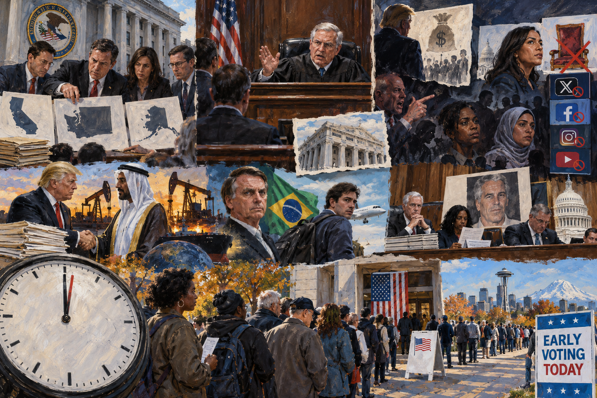

<!-- Generated by build_publish_week_v1 -->
<!-- Header image: image_wide_week93.png -->

# Week 93: The Week the Clock Held Its Breath

*DOJ waged an unprecedented legal siege on a national election while courts, officials, and voters refused to yield ground.*

The week did not arrive as a single blow. It arrived as a siege, conducted in the language of procedure, filed in courtrooms, delivered through subpoenas, pressed into the final days before an election the executive branch seemed determined to contest before it happened. For ninety-three weeks, the Democracy Clock has measured exactly this kind of pressure, not the spectacular rupture but the accumulation of small claims on power. Taken together, those claims redraw what a government may do to the people who are supposed to judge it. This week tested one question more directly than most: could an incumbent administration use federal law enforcement to stop an election from concluding against it?

At the close of last week, the clock stood at 7:34 p.m. It remains at 7:34 p.m. this week, a net movement of two-tenths of a minute, the smallest shift in months. That stillness is not peace. It reflects two forces nearly canceling each other: an extraordinary, multi-front assault on election administration pushing the hour backward, and a judiciary that held its ground with unusual bluntness, pushing just as hard the other way. The clock's quiet this week is the record of a fight, not the absence of one.

The fight began with a list. The Department of Justice handed California election officials a roster of alleged noncitizen voters and gave them forty-eight hours to pull twenty thousand ballots from the count. The list was riddled with errors. More than forty percent of the names did not appear on California's voter rolls at all. A federal agent delivered the ultimatum with a threat of prosecution attached. The county clerk refused. He had no legal basis to comply, and he said so. This was the opening move in what became the week's defining story: a federal government willing to threaten ordinary election administrators with criminal charges to shape an outcome before votes were even tallied.

DOJ did not stop there. Across the week, government lawyers returned to court again and again, seeking the same result through different doors. A federal district judge denied the request, calling it a threat that would "wreak havoc" on voting. The Ninth Circuit denied it again on appeal. DOJ sought an emergency stay. That too was denied. By week's end, a judge found that the administration had engaged in a sustained pattern of coercion against the people who run California's elections, and barred the department from making further threats. The lawsuits did not stop. They simply kept losing.

The California fight was not isolated. The same week, DOJ pushed into Washington state, demanding four hundred ballots be set aside over a list that, officials discovered, included American citizens. Grand jury subpoenas went out to election workers in thirteen states. A letter went to officials in all fifty, warning of possible jail time for failing to preserve records, issued despite a judge's prior order that DOJ stop threatening election workers altogether. Roughly a thousand federal officials were sent to polling places nationwide, concentrated disproportionately in Hispanic-majority, Democratic-leaning precincts. State officials quietly began preparing for the possibility of their own arrest on Election Day. A Maryland election administrator drew up contingency plans. A Michigan attorney general drafted briefs anticipating a constitutional fight. In a single week, running American elections had become something that required a lawyer on retainer.

Alaska carried its own version of the same story, narrower but no less direct. At the president's personal order, DOJ sued preemptively to block certification of the state's Senate race, contingent on the Republican incumbent losing. The president then called publicly for his opponent, Mary Peltola, to be removed from the ballot and prosecuted, over a legal if unusual campaign tactic involving a candidate who shared the incumbent's name. Alaska's governor opened a parallel criminal investigation into Peltola's campaign without specifying what law had been broken. State and federal power moved together, aimed at one candidate, before a single vote had been certified. A federal judge later dismissed the DOJ suit as not even legally possible to grant. The attempt itself was the event. Its failure did not erase what it revealed: a White House prepared to treat an electoral loss as inherently illegitimate, and worth suing to prevent.

Alongside the legal campaign ran a parallel campaign conducted in words. The president offered a million-dollar bounty for voter-fraud tips, with no evidence of fraud at the scale implied. He falsely claimed a sitting congresswoman had conceded her seat. He called a Senate candidate a jihadist. At a South Carolina rally, he said Black and Jewish voters backing his opponent were "crazy." Platforms compounded the damage. Meta suspended the Instagram account of a pro-voting organization and of at least one Democratic Senate campaign during active voter outreach, prompting a formal congressional inquiry. Attorney General Blanche publicly branded Peltola's legal campaign tactic "cheating" and "fraud," lending the Justice Department's weight to a claim with no legal basis. No single act rewired the election. Together, in the week before one, they thickened the fog around what voters could trust.

Abroad, the administration's posture toward foreign power followed a familiar shape: welcome where it served personal or regime interest, hostile where it did not. The president waived sanctions on a Russian-linked energy firm two days before they would have taken effect, clearing the way for a private Alaska gas deal. Cabinet secretaries signed a Venezuelan oil venture with a figure accused of money laundering, structured through offshore entities. When Brazil's election produced a clear, internationally recognized win for Lula, the White House response was not congratulation but suspicion. The president called the result "rigged" and "corrupt," while his administration quietly arranged humanitarian status for Flávio Bolsonaro, son of the defeated and legally embattled former president, helping him leave the country. Foreign policy, in this telling, is not a function of alliance or law. It is a ledger of favors, extended to those who serve the regime's interests and withheld from those who do not.

Domestic oversight faced its own quieter erosion. House Judiciary Democrats released a staff report detailing new allegations connecting the president to Epstein-related misconduct and accusing DOJ of obstruction. They called for an independent special counsel, a request with no binding force, since they lack subpoena power. Separately, new claims surfaced that Attorney General Blanche had directed a witness not to discuss allegations implicating the president. If borne out, that detail would move beyond political embarrassment into obstruction of justice. The administration, meanwhile, reportedly weighed blanket pardons for junior staff, a step that would strip away any remaining incentive for insiders to cooperate with investigators. Each development, alone, might be dismissed as partisan noise. Together they describe a Justice Department increasingly understood, even by its own former officials, as a shield for the president rather than a check on him.

Against all of this, the judiciary held. The Ninth Circuit rejected DOJ's ballot-segregation demand not once but twice. A federal judge disqualified a Trump-appointed U.S. attorney in Los Angeles for serving unlawfully without Senate confirmation. Another judge enjoined a HUD suspension of a homelessness authority. A grand jury declined to indict Cassidy Hutchinson, the January 6 witness whose testimony has made her a recurring target. None of these rulings reversed the week's broader direction. But they showed, concretely, that courts retain both the capacity and the will to say no, even under the sheer volume of pressure DOJ applied. That capacity is not guaranteed by law alone. It depends on judges willing to use it, again and again, against an executive branch that keeps asking the same question in different words until it gets the answer it wants.

Not every thread of the week concerned elections directly. The administration enacted what reporting described as the largest federal healthcare cut in American history, roughly a trillion dollars from Medicaid. That shift will fall hardest on hospitals and low-income patients, and it drew far less attention than the ballot fights dominating the news. The Catholic Archdiocese of New York finalized an eight-hundred-million-dollar settlement with more than thirteen hundred abuse survivors, proof that civil accountability, however slow, can still reach powerful institutions. And American voters, undeterred by threats of prosecution and confusion over ballot validity, cast more than forty-six million early votes, already exceeding the entire 2022 midterm total. Suppression and turnout moved forward in the same week. Neither canceled the other. Both belong to the same record.

The pattern across these developments is not sudden seizure. It is probing. DOJ tested how far it could push election officials before a court said stop. It tested that boundary in California, then Washington, then nationwide, absorbing losses in court while still applying pressure through subpoenas and public threats that needed no judge's permission. The repetition itself is a strategy. Even unsuccessful litigation extracts a cost. It drains the time and resources of local officials. It breeds doubt about ballot legitimacy among voters who do not follow the appellate docket. And it makes the idea routine that a losing campaign might simply ask a court to erase the loss.

The week also showed how thin the line has grown between institutional action and personal grievance. Sanctions waivers served a private deal. Humanitarian status served a political ally's family. A criminal investigation targeted a single Senate candidate at the moment her opponent might lose to her. In each case, the machinery of state moved in a direction that happened to align precisely with the material or political interests of the people operating it. Repeated often enough, that alignment stops looking like coincidence.

What held the line this week was not restraint from the executive branch. It was resistance from outside it: courts that kept ruling against DOJ's demands, election officials who refused threats despite personal risk, journalists and advocates who tracked the holes in government fraud claims, and tens of millions of voters who showed up anyway. The system did not fail this week. But it was tested in ways that revealed how much of its integrity now depends on people willing to say no, case by case, with no guarantee the next refusal will hold.

There is no scheduled ruling or settled action to report. The Alaska certification fight, the California ballot litigation, and the various subpoena challenges remained open as the week closed, with results expected only as the election itself unfolded.

Ninety-three weeks into this term, the record shows a government that has learned to test boundaries methodically, retreating when courts intervene, returning when pressure can be applied elsewhere. This week added little to the clock's arithmetic, but it added considerably to the evidence of method. It shows how an administration can treat an election as negotiable, press that claim through dozens of channels at once, and still find itself checked, for now, by institutions built to outlast any single administration's ambitions. Whether those institutions can keep absorbing this much pressure, week after week, remains the question this record exists to answer.

<!-- Synopses for cross-posting -->
Long Synopsis: In the week before a national election, the Department of Justice mounted a coordinated campaign to challenge vote counts in California and Washington, block certification of Alaska's Senate race, and threaten election officials nationwide with prosecution. Courts repeatedly rejected these efforts, with one judge calling the conduct unprecedented coercion. Alongside the legal campaign ran a parallel assault in words: a million-dollar fraud bounty, false claims about a congresswoman's seat, racial and religious slurs against candidates, and platform suspensions of opposition accounts. Abroad, sanctions waivers and oil deals served personal interests while the administration delegitimized Brazil's election and sheltered a fleeing former president's son. Congressional oversight of Epstein-related allegations continued without subpoena power. The clock moved only two-tenths of a minute, reflecting a near-even contest between aggressive overreach and institutional resistance. More than forty-six million Americans voted early anyway.
Short Synopsis: DOJ waged a multi-front legal and rhetorical campaign to contest an election before it concluded, threatening officials, suing to block certification, and flooding the information space with disinformation. Courts pushed back repeatedly. The clock barely moved, but voters turned out in record numbers regardless.

